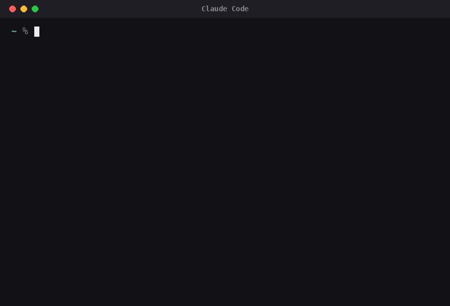

# Legacy Mentoring · Central Escala (Low Ticket + Nutra)

Criado por **Gabriel Rodrigues** · [@gabrielrodriguesfx](https://instagram.com/gabrielrodriguesfx)

[](https://instagram.com/gabrielrodriguesfx)



> Passo a passo: adicionar o catálogo, instalar a skill e abrir com `/escala` no Claude Code. Os comandos estão logo abaixo para copiar.

## Sobre mim

Sou o **Gabriel Rodrigues** ([@gabrielrodriguesfx](https://instagram.com/gabrielrodriguesfx)), fundador da **Legacy Mentoring**.

Hoje faturo **mais de 1 milhão de euros por mês** vendendo nutra na Europa, mas sei bem quais são os gargalos de quem está começando.

Por isso resolvi ajudar com o meu conhecimento, e esta ferramenta é uma das formas de fazer isso. Como eu já rodei e comecei pelo low ticket, esta ferramenta auxilia iniciantes no mercado digital!

## O que é

Plugin para o Claude Code que minera ofertas escaladas na Biblioteca de Anúncios da Meta, em segundo plano e sem abrir o seu navegador. Ele tem dois modos:

**🏷️ Low ticket (Brasil)**
- Encontra infoprodutos baratos (packs, kits, apostilas, mapas mentais · R$ 7 a 47) por nicho e palavra-chave.
- Descarta grandes empresas e e-commerce (Alibaba, Shopee, Amazon, lojas de produto físico).
- Reconhece a estrutura da copy de low ticket: gancho de dor, "+100 …", "Ideal para:" com lista de emojis, CTA "saiba mais" e preço âncora.
- Também minera pelo Reclame Aqui: os produtos mais reclamados nas plataformas BR (Kiwify, Hotmart, Cakto…).
- E pelo **urlscan.io**: encontra páginas que usam o rastreador da **UTMify** (ofertas do digital rodando tráfego) e entrega o link para conferir os anúncios de cada domínio na biblioteca. Não precisa de setup.

**💊 Nutra (qualquer país)**
- Escolha o país (EUA, Alemanha, França, Espanha, Itália, Reino Unido, Portugal, Brasil ou qualquer outro) e a busca é feita **no idioma daquele país**.
- 7 categorias com mais de 100 mecanismos prontos: emagrecimento, diabetes, ED, próstata, prosperidade, renda extra e relacionamento.
- Exemplos: truque do cavalo, truque do bicarbonato (*baking soda trick*), truque da gelatina, truque da aveia, truque da canela, truque do gengibre…
- Identifica a plataforma (Digistore24, ClickBank, BuyGoods, MaxWeb) e os sinais de VSL/advertorial.

**Em todos os modos**, a ferramenta mostra os sinais de escala:
- 🔥 **escala**: página com 5+ anúncios ativos
- 💰 **lucrativo**: anúncio rodando há 30+ dias
- 🎬 **testando**: vídeos com variações

E entrega o link da biblioteca de cada página.

## Antes de começar

- **Mac** (macOS 13+) ou **Windows** 10/11. No Windows, instale também o **Git para Windows** (https://git-scm.com/downloads/win) — ele traz o Git Bash que o Claude Code usa para rodar a ferramenta.
- Conta paga do Claude (Pro, Max, Team ou Enterprise)
- Claude Code instalado. Se não tiver, cole no Terminal:

  ```bash
  curl -fsSL https://claude.ai/install.sh | bash
  ```

  Depois feche e abra o Terminal e rode `claude` uma vez para fazer login.

## Instalar

**Jeito fácil (um comando só):**

No **Mac/Linux**, no Terminal:
```bash
curl -fsSL https://raw.githubusercontent.com/GabrielDEVX/Minerador-Claude-Skill-LowTicket/main/instalar.sh | bash
```
No **Windows**, no PowerShell:
```powershell
irm https://raw.githubusercontent.com/GabrielDEVX/Minerador-Claude-Skill-LowTicket/main/instalar.ps1 | iex
```
Ele instala o Claude Code (se faltar), adiciona o catálogo e instala o plugin. No Windows, lembre de ter o **Git para Windows** instalado.

**Ou manualmente, no Terminal:**

```bash
claude plugin marketplace add GabrielDEVX/Minerador-Claude-Skill-LowTicket
claude plugin install escala@legacy-mentoring
```

## Usar

```bash
cd ~ && claude
```

Dentro do Claude Code, na primeira vez, digite:

```
/escala:escala
```

1. Na primeira vez, digite `/escala:escala` e escolha **1 (setup e diagnóstico)**. Leva alguns minutos e cria o atalho `/escala`. Depois disso, é só digitar `/escala`.
2. Depois, **2 (minerar ofertas escaladas)**:
   - **Low ticket**: escolha o método (Reclame Aqui, Biblioteca de Anúncios ou urlscan.io), o nicho e a palavra-chave.
   - **Nutra**: escolha o país, a categoria e o mecanismo.

Os resultados ficam em `~/mineracao/` (para abrir: `open ~/mineracao`).

## Novidades

**1.10.0**
- **Trava de atualização**: a ferramenta checa a versão mais recente no GitHub e **bloqueia a mineração** se estiver desatualizada, pedindo para atualizar antes (1 comando). Sem internet, não bloqueia. O menu também avisa quando saiu versão nova.

**1.9.0**
- **Funciona no Windows** (além de Mac e Linux): os scripts detectam o Python do sistema e o ambiente em `Scripts\\python.exe`; o atalho `/escala` é criado por cópia quando não há link simbólico. Requisito no Windows: ter o **Git para Windows** (Git Bash). Instalador PowerShell incluído.

**1.8.0**
- **Entregável como área de membros**: o infoapp agora é uma área de membros completa — dashboard com anel de progresso e "continuar de onde parei", e abas **Início / Conteúdo / Bônus / Suporte**. Mesmo layout base para todos os nichos, com a cor de cada um. Os bônus e o canal de suporte entram pelo `conteudo.json`.
- **Vídeo** (GIF) no topo do README mostrando a Central aberta dentro do Claude Code com `/escala`.

**1.7.1**
- Página de vendas (opção 5) refeita no **layout validado**: hero com mockup e números, "veja por dentro", "para você que", bônus com preços, **dois planos** (básico e completo em destaque), garantia e FAQ. As imagens (mockup, prévias, bônus) entram quando você aponta os arquivos.

**1.7.0**
- Opções 3 a 6 agora funcionam, fechando o ciclo do garimpo à oferta pronta:
  - **3 · Analisar**: dá uma nota de 0 a 10 à oferta (dias rodando, ativos, criativos, preço, concorrência) e um veredito (modelar / observar / descartar).
  - **4 · Entregável**: gera um **infoapp** (app web que o comprador instala no celular, com módulos, progresso e modo offline) e um zip pronto para publicar.
  - **5 · Funil**: monta a estrutura do funil e gera a **página de vendas em HTML** (headline, oferta de/por, order bump, garantia, FAQ), mais o link de checkout com rastreamento da UTMify.
  - **6 · Criativos**: ganchos, roteiros de vídeo, legendas e briefings de imagem no ângulo da oferta validada.

**1.6.0**
- **Relatório visual**: toda mineração gera um `relatorio.html` para abrir no navegador — cards com os sinais, mini-gráfico de tendência, copy, plataforma e botões (ver anúncios, landing, favoritar), com filtros e ordenação.
- **Radar**: a ferramenta guarda o histórico de cada página; ao repetir a mesma busca, mostra quem está **subindo** (escalando agora) e quem parou. Comando: `run.sh radar`.
- **Favoritos / swipe file**: salve ofertas e criativos com etiquetas e busque depois.
- **Comparar países (nutra)**: rode o mesmo mecanismo em vários países e veja onde está mais quente.
- **Aviso de atualização** e versão no menu; **instalador em um comando**.
- Filtro mais preciso: descarta anúncios que levam para WhatsApp/DM (negócio local) e catálogos de e-commerce.

**1.5.1**
- Menu: removida a opção Meta Ads; Configurações agora é a opção 7.

**1.5.0**
- O comando agora é **`/escala`** (o nome completo do plugin é `/escala:escala`; o setup cria o atalho `/escala`).
- **Quem tinha a versão anterior:** rode `claude plugin uninstall lowticket@legacy-mentoring`, depois `claude plugin marketplace update legacy-mentoring` e `claude plugin install escala@legacy-mentoring`. Suas configurações continuam salvas.

**1.4.0**
- Novo método **urlscan.io**: busca páginas que carregam a UTMify, agrupa por domínio, mostra título, data do último scan, plataforma e o print do urlscan, com o link pronto para a Biblioteca de Anúncios.
- Configurações (7) › 15 e 16: chave grátis do urlscan.io (opcional, aumenta o limite) e rastreadores buscados.
- Correção: o status só fica PRONTO quando o navegador foi realmente baixado. Se você já tinha feito o setup antes, rode a opção 1 de novo uma vez.

**1.3.0**
- Filtro de nutra treinado com anúncios reais (DE/FR): gancho de dor em pergunta em vários idiomas, lista de benefícios com ✨, CTA "Klicken Sie hier / Click here", promessa de transformação e advertorial ("L'énigme est résolue").
- Lê o **nome do produto** (ex.: Slim Jara) e reconhece página com nome de pessoa.
- Nova coluna **tipo provável** da landing (advertorial, VSL, presell, quiz, checkout, loja), deduzido pelo link e pelo título. A página não é aberta: para ver a landing de verdade, abra o anúncio pelo celular.
- As correções de fábrica agora chegam a todos nas atualizações; o que você ensinou ao filtro continua salvo.

**1.2.0**
- Modo **Nutra**: mineração por mecanismo em qualquer país, com busca no idioma local.
- 7 categorias e mais de 100 mecanismos prontos (os principais aparecem primeiro; os outros ficam a um toque).
- Filtro próprio para nutra e detecção de plataforma (Digistore24, ClickBank, BuyGoods, MaxWeb).

**1.1.1**
- Créditos ao criador nos menus.

**1.1.0**
- Filtro low ticket: ignora Alibaba, Shopee, Amazon, bancos, marcas e lojas de produto físico.
- Reconhece a estrutura da copy de infoproduto (gancho de dor, "+100 …", "Ideal para:" com lista de emojis, CTA "saiba mais / veja por dentro", preço âncora).
- Menus novos, mais organizados.
- Configurações (7) › 12: ensine o filtro colando a legenda de um anúncio.

## Como atualizar (importante)

> **A ferramenta não deixa minerar desatualizada.** Toda vez que você vai minerar, ela confere no GitHub se há versão nova; se houver, ela para e pede para você atualizar antes (é 1 comando). Isso garante que todo mundo use sempre a versão mais recente.


Esta ferramenta recebe melhorias com frequência. **As atualizações não são automáticas** — cada pessoa precisa puxar a versão nova no seu próprio computador, com 1 comando.

**Para atualizar**, abra o Terminal (Mac/Linux) ou o PowerShell/Git Bash (Windows) e rode:

```bash
claude plugin marketplace update legacy-mentoring
```

Pronto. Depois, se a atualização mexeu no ambiente, abra o Claude Code, digite `/escala` e rode a opção **1 (Setup)** uma vez.

**Como saber que saiu versão nova?** Sempre que você abrir o menu com `/escala`, a ferramenta avisa no topo se existe uma versão mais recente e mostra o comando de atualizar. Você também pode conferir a versão instalada no rodapé do menu.

**Suas configurações não se perdem:** nichos, palavras-chave, faixa de preço, filtros que você ensinou e favoritos ficam em `~/.lowticket/` e continuam iguais depois de atualizar.

> Dica para quem distribui a ferramenta: avise seu grupo quando sair uma versão nova. Quem não rodar o comando de atualizar continua na versão antiga (funcionando, mas sem as novidades).

## Problemas comuns

| Mensagem | O que fazer |
|---|---|
| `command not found: claude` | Instale o Claude Code (comando acima) e abra um Terminal novo |
| `PYTHON_FALTANDO` | Rode `xcode-select --install`, conclua e rode o setup de novo |
| `anuncios_lidos=0` ou `BLOQUEIO` | Espere alguns minutos e tente de novo, com menos palavras por vez |
| `SETUP_PENDENTE` | Rode a opção 1 do menu |
| `LIMITE` (urlscan.io) | Espere alguns minutos ou cadastre uma chave grátis do urlscan.io (Configurações (7) › 15) |

---

## Me siga

Gostou da ferramenta? Me segue no Instagram para receber as atualizações, novas skills e conteúdo de low ticket:

👉 **[instagram.com/gabrielrodriguesfx](https://instagram.com/gabrielrodriguesfx)**

Feito por **Gabriel Rodrigues** · [@gabrielrodriguesfx](https://instagram.com/gabrielrodriguesfx) · Legacy Mentoring
